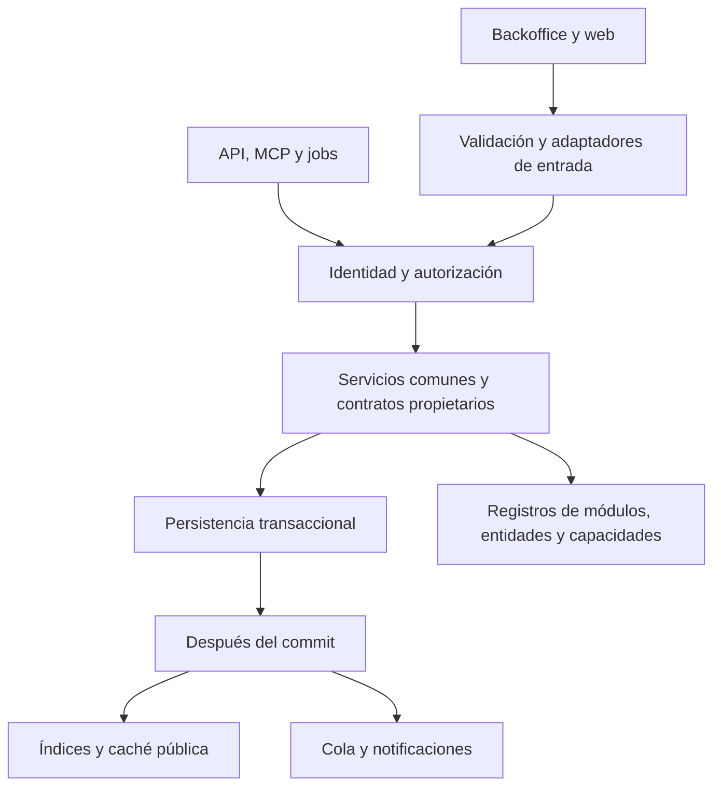

# Arquitectura y código mantenible de dbCMS

Actualización: 12 de octubre de 2026. Esta guía describe las fronteras del código
actual y las reglas para extenderlo. La [guía de mantenimiento](ARCHITECTURE_MAINTENANCE_GUIDE.md)
explica decisiones, recorridos, verificaciones y límites heredados.

## Modelo de aplicación

dbCMS es un monolito modular Laravel. Núcleo, módulos y transportes comparten
proceso y base de datos; sus contratos separan responsabilidades. Los módulos no
son servicios aislados ni una caja segura para ejecutar PHP de terceros.

## Fronteras

- **Presentación:** valida y convierte Request/session/firma en datos explícitos;
  llama al servicio; construye la respuesta. Nuevas acciones son invocables y
  breves. No implementan publicación, inventario o aprobación editorial.
- **Aplicación y dominio:** coordinan políticas y persistencia usando contratos.
  Las consultas viven en lectores propietarios; las mutaciones usan servicios
  compartidos y sus handlers. Leer no requiere abrir una transacción de escritura.
- **DTO:** `readonly`, tipos y colecciones documentadas. La inmutabilidad de sus
  propiedades no convierte un modelo Eloquent contenido en un objeto inmutable.
  Los nuevos DTO de dominio no reciben un Request; el adaptador lo convierte.
- **Persistencia:** Eloquent, relaciones, casts y scopes. Efectos externos en
  servicios/jobs; transacciones locales y bloqueos donde protege un invariante.

Los lectores públicos devuelven `FrontPageData` con vista/datos, redirección o
recurso ausente; `FrontPageResponseMapper` construye HTTP. Es un contrato de
presentación de aplicación, no un dominio independiente de Laravel. El locale,
mercado y URL llegan mediante `PublicContentContext`; no se fabrica un Request
dentro de la consulta para obtener contexto.

## Extensiones

Cada módulo registra entidades, handlers, bloques, fuentes de búsqueda,
contribuidores públicos y capacidades en su proveedor. El núcleo depende de
contratos estables y no de implementaciones de extensiones opcionales. La nueva
frontera editorial y la de mantenimiento tienen implementaciones neutras para
instalaciones donde no exista el módulo; una operación ausente nunca concede
aprobación o anuncia un cambio realizado.

Hay adaptadores heredados que conocen entidades incorporadas. Su presencia no
acredita independencia de toda combinación de carpetas. Las pruebas de arquitectura
comprueban fronteras explícitas, mientras las pruebas funcionales comprueban
permisos, efectos y disponibilidad. Al cambiar un área heredada se extrae su
responsabilidad conservando rutas, formatos y reglas comunes.

## Verificación

Usar Docker/Sail para PHP, Composer y Node. Reproducir los defectos antes de
corregirlos y ejecutar `bin/ci-check` en el runtime CI aislado descrito en
[Zero Host](06_ZERO_HOST_PHP_SAIL_RUNBOOK.md). PHPStan nivel 8 no usa baseline ni
exclusiones generales; su alcance real está en `phpstan.neon`. Pest, estilo,
contratos y análisis estático aportan evidencia distinta; ninguno certifica por
sí solo seguridad, rendimiento o corrección absoluta.
