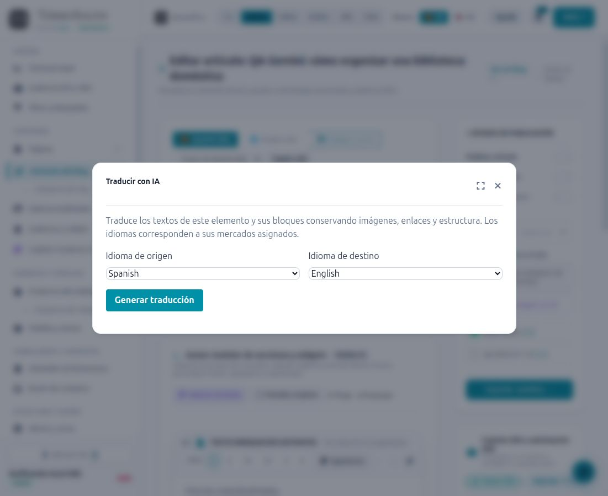
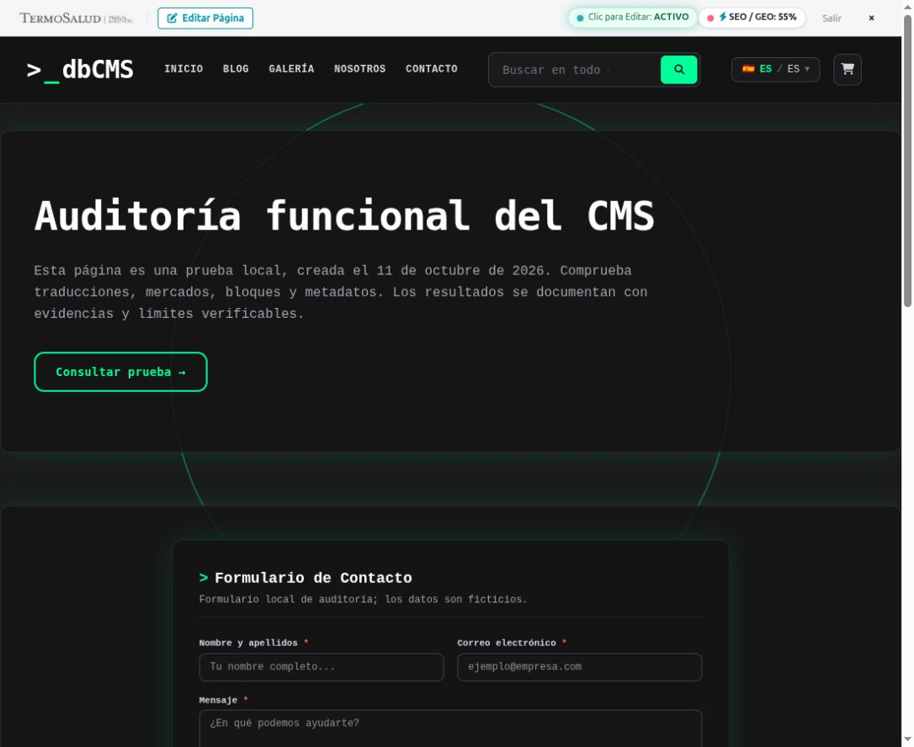
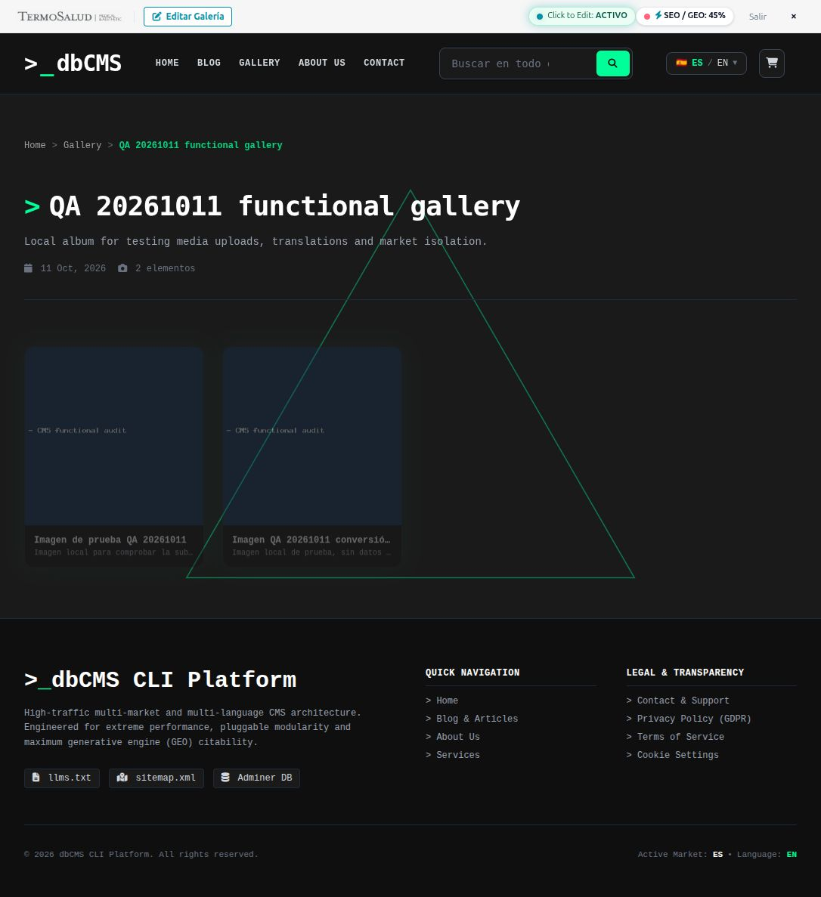
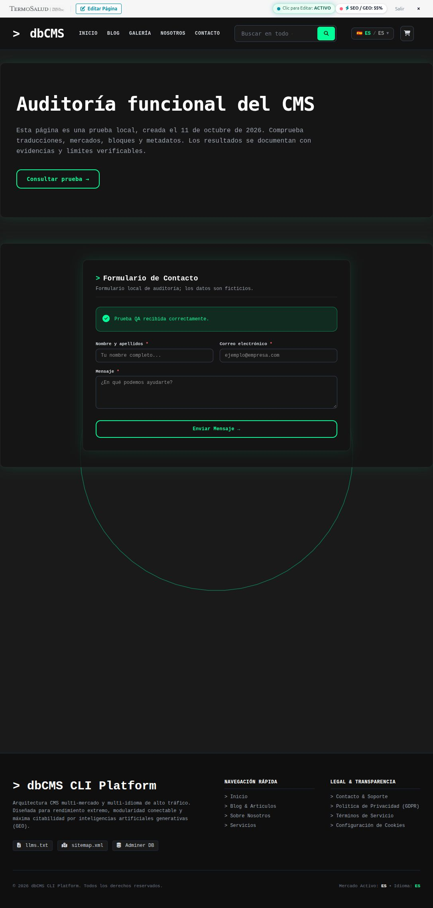
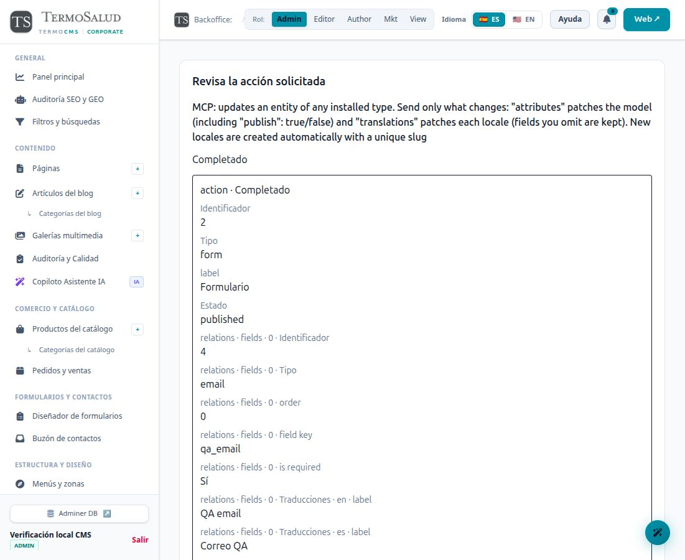
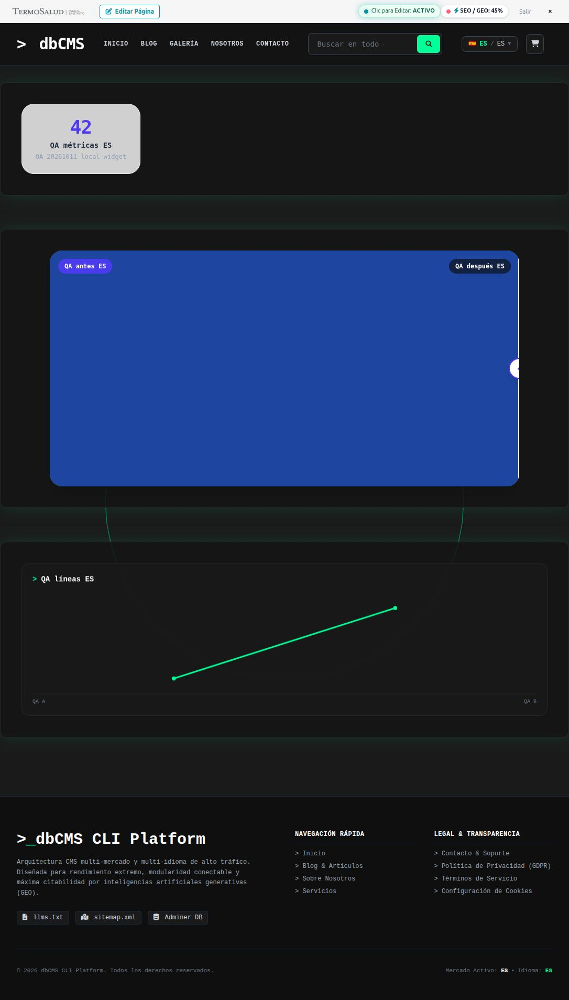
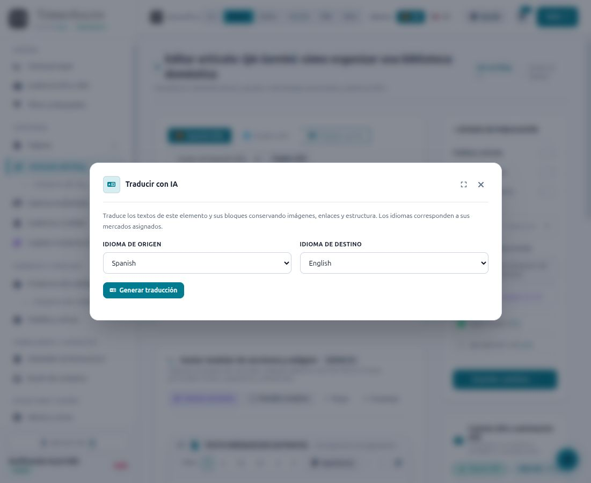
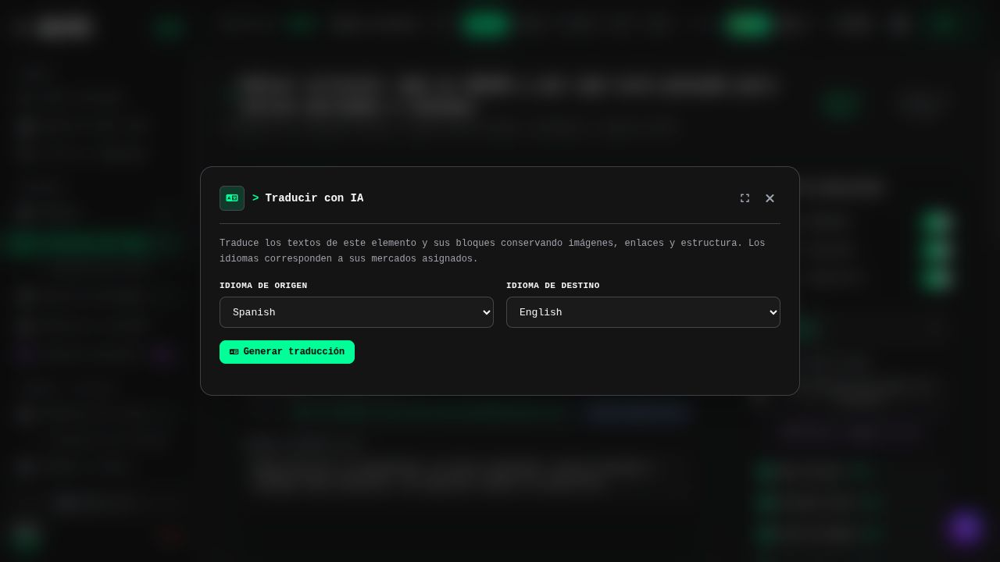
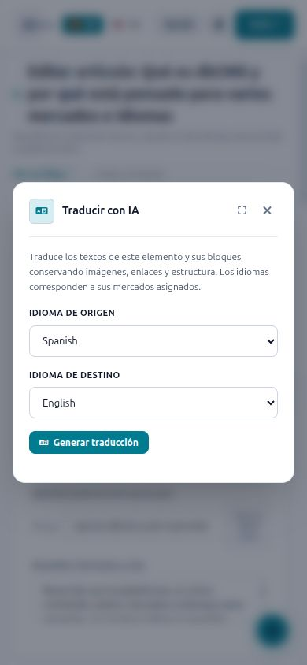
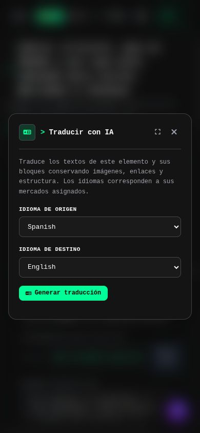

# Auditoría funcional del CMS — 11 de octubre de 2026

## Resultado y alcance

Se revisaron los **16 módulos instalados**, los servicios compartidos, las pantallas administrativas y las superficies públicas. Se crearon datos QA mediante navegador y MCP, se revisaron sus publicaciones en el backoffice y se comprobaron pedidos, formularios, idiomas, mercados, búsqueda y medios. Se corrigieron defectos reproducidos durante la auditoría. El sistema tiene una base modular útil, pero **no se certifica funcionamiento universal con cualquier proveedor ni resultados perfectos de SEO, GEO o AEO**.

Entorno: Sail local, `http://localhost:8080`, Laravel 13.32.0, MySQL y Redis. El chequeo de soporte de Laravel respondió correctamente; no equivale a una certificación de seguridad completa. Se preservaron los cambios previos del repositorio y los registros del 10 de octubre. No se desplegó, publicó código ni hicieron commits. La copia privada previa de la base se guarda en `storage/app/runtime-verification/module-audit-20261011/before.sql`, con permisos restrictivos; no debe versionarse ni compartirse.

Las pruebas que recrean tablas se ejecutan en contenedores y base de datos independientes. Las regresiones ejecutadas dentro del Sail del sitio usan dobles, SQLite en memoria o modelos sin persistencia. No se ejecutó `RefreshDatabase` contra la base de desarrollo.

## Matriz por módulo

«HTTP real» significa una petición al servidor local; «contrato» significa ejecución con fixtures o HTTP simulado; «pendiente» identifica lo que no se ha demostrado en un proveedor externo.

| Módulo | Prueba realizada | Resultado y límite |
| --- | --- | --- |
| Pages | Página bilingüe creada por navegador; edición, revisión, aprobación y representación de bloques de formulario y galería | Página QA 2 pública ES/EN. Se corrigió la resolución de traducciones para impedir sustituir una traducción inexistente por otra. |
| Blog | Categoría ES/EN, artículo ES/EN, metadatos, cuerpo, revisión y publicación; RSS y búsqueda | Artículo QA 3 público en ambos idiomas. Se corrigió la pérdida de traducciones inactivas y el aislamiento del RSS. |
| Gallery | Álbum bilingüe, medios, orden, metadatos, revisión y representación pública | Galería QA 1 con dos imágenes. Nueva imagen WebP con ALT persistido. Se corrigieron edición 500, pérdida de traducciones y disponibilidad por mercado/idioma. |
| Forms | Constructor UI, campos ES/EN, envío público y buzón privado; creación/edición MCP | Formulario UI 1 con tres campos y envío 1 recibido. Formulario MCP 2 publicado mediante aprobación UI, ejecución completada y dos campos localizados conservados. |
| Shop | Categoría/producto MCP, aprobación, carrito, dos checkouts, pedidos firmados, presupuesto y estados | Transferencia y COD pendientes/no pagados. Stock 3→1; precio específico cero respetado; tarjeta y acceso ajeno rechazados. No pasarela real probada. |
| Search | Reconstrucción del índice y búsqueda pública EN tras publicación | Tres documentos: artículo ES/EN y producto ES. Búsqueda EN devuelve el artículo y su URL correcta. Sólo se indexan tipos registrados; páginas/galerías no se anuncian como indexadas si no tienen adaptador. |
| ContentAudit | Revisiones reales de página, artículo y galería; snapshot de campos Forms y revisión humana | Los cambios publicados se conservan hasta aprobar la revisión. La puntuación editorial es una heurística, no una medición de citas ni detector infalible de autoría. |
| MCP | Descubrimiento, catálogo, CRUD, aprobaciones, nativo/legacy y SSE | HTTP 200 autenticado; anónimo 401; aislamiento entre tokens y revocación verificados. Ocho entidades y trece recursos anunciados en el probe. |
| AI Assistant | Ajustes, permisos, conexión y generación real; contexto desde prompt/editor, guardado y aclaraciones | OpenAI autentica, pero `gpt-4o` está bloqueado por saldo. Gemini `gemini-2.5-flash` generó texto, bloques, corrección, humanización y SEO. Plan nativo: artículo QA 4 ES/EN sin publicar. UI: artículo QA 5 EN/UK y bloque heredado; guardado conserva el contexto. La última composición queda pendiente por HTTP 429. Véanse alcance y regresiones posteriores. |
| Charts | Render de bar/donut/line/metric y página pública MCP con KPI y gráfico line | Página QA 3 ES/EN muestra etiquetas localizadas y datos ficticios explícitos. Se corrigieron etiquetas ignoradas y escape de extremos de línea. |
| BeforeAfter | Página QA 3 con imágenes locales, etiquetas y control range | HTTP 200; teclado End cambia 50→100 y overlay a 100%. Arrastre/táctil y accesibilidad completa no certificados; falta nombre accesible del control. |
| Captcha | Driver interno, expiración y consumo del desafío | Replay corregido mediante consumo atómico. No se resolvieron captchas de proveedores ni se configuró reCAPTCHA/Turnstile. |
| Analytics | Disponibilidad, escape de IDs, consentimiento, revocación y CSP | GA4 probado con fixtures. Sin ID real no se enviaron eventos. GTM se anuncia en ajustes pero carece de consumidor. |
| Ads | Ajustes y renderer aislado con valores válidos/maliciosos | Escape/validación corregidos. Falta integración del renderer/loader con los temas; no se certifican anuncios reales. |
| Meta | Ajustes y contrato CAPI mediante HTTP simulado | Token movido de URL a cuerpo POST y eliminado de logs de errores. Faltan integración Pixel/listeners y recepción real de conversiones. |
| Maintenance | Configuración HTTP, permisos y estado consultado por MCP | Estado local desactivado. El bloqueo global no se activó sobre la sesión de trabajo; su prueba corresponde al entorno aislado. |

Las 16 páginas administrativas de configuración devolvieron HTTP 200. Eso acredita su acceso y renderizado, no la correcta entrega de una integración externa.

## Servicios compartidos y límites de cobertura

| Área | Evidencia disponible | Límite |
| --- | --- | --- |
| Orquestación nativa | Ejecuciones MCP reales con revisión UI; suite aislada de referencias, checkpoints, idempotencia, cancelación y permisos al reanudar. Rechaza aprobación aportada como argumento por OAuth/modelo. | El planificador usa HTTP simulado en sus contratos; sin credencial no se comprobó un plan propuesto por un LLM remoto. La entrada de instrucciones libres sigue deshabilitada por configuración. |
| Caché pública | Tests aislados de exclusión de visitantes autenticados/editor, hidratación de CSRF/Captcha/CSP y protección frente a caché upstream; invalidación de página/listados/menús y revisión. | No hubo prueba de carga ni un proxy/CDN real. Las pruebas de formularios UI no sustituyen esa verificación de infraestructura. |
| Ciclo de módulos | Suite aislada: rutas y consumidores dejan de estar disponibles al desactivar; desinstalar Blog conserva su registro de contenido y no permite reactivarlo con una simple activación. Instalación sin módulos mantiene el core accesible. | No se desinstalaron los 16 módulos del sitio ni se certificó cada combinación de reinstalación sobre datos históricos. |
| Instalación y medios | Suites CLI/web y permisos/MIME/traversal/SVG; upload WebP real y bloqueo Nginx de PHP probado en imagen de producción. | No instalación manual en un alojamiento externo, subida remota ni conciliación automática de medios antiguos. |

## Datos creados y conservados

| Entidad | Identificador | Acceso o estado |
| --- | --- | --- |
| Idioma inglés | 2 (`en`) | Activo; asociado al mercado ES, conservando español por defecto |
| Mercado QA UK | 2 (`uk`) | GBP/EN; aprobado por revisión UI |
| Categoría Blog QA | 1 | Traducciones ES/EN, mercado ES |
| Página QA | 2 | `/es/es/qa-20261011-modulos` y `/es/en/qa-20261011-modules` |
| Página QA widgets | 3 | `/es/es/qa-20261011-widgets` y `/es/en/qa-20261011-widgets`; tres bloques publicados por MCP con aprobación UI |
| Artículo QA | 3 | `/es/es/blog/qa-20261011-verificacion` y `/es/en/blog/qa-20261011-verification` |
| Galería QA | 1 | `/es/es/galeria/qa-20261011-galeria` y `/es/en/gallery/qa-20261011-gallery` |
| Imágenes del álbum | 2 elementos | Segunda imagen con ALT descriptivo y MIME WebP verificado |
| Formulario UI | 1 (`qa-20261011-form`) | Tres campos, etiquetas ES/EN; insertado en página QA 2 |
| Formulario MCP | 2 (`qa-20261011-mcp-form`) | Dos campos ES/EN; activación aprobada y ejecución completada |
| Envíos de formulario | 1 y 2 | UI/Form1 y HTTP/Form2; datos ficticios `.test`, buzón privado |
| Menú auxiliar / elemento | 1 / 1 | Etiquetas ES/EN; sin sustituir zonas de navegación existentes |
| Landing de filtro SEO | 1 | Un resultado, inferior al umbral de tres: no debe anunciarse indexable |
| Categorías Shop | 1, 2, 3 | Dos borradores exploratorios preservados; categoría 3 aprobada |
| Producto Shop | 1 (`QA-20261011-SHOP`) | `/es/es/tienda/qa-20261011-shop-producto`; stock final 1 |
| Pedidos | 1 y 2 | Transferencia/COD, ambos `pending/unpaid`, total 0 por precio específico ES |
| Solicitud de presupuesto | 1 | Persistida, revisada por MCP; notificación a Mailpit local |
| Usuario QA sin roles | 2 | Conservado sin ampliar permisos; acceso privado rechazado |
| Tarea IA negativa | `86417917-0870-4fb7-bee1-c6f39ac79c0e` | `page_element`, `failed`, sin proveedor/modelo ni contenido generado por falta de conexión |
| Medios | 1, 2, 3 | Primer upload conserva evidencia del MIME incorrecto/original duplicado; último upload corregido |

Los enlaces firmados de pedidos, contraseñas, cookies y tokens no se incluyen. Los tokens/clientes temporales creados para los probes se revocan al cerrar sus pruebas; los registros QA permanecen para revisión. Los borradores anteriores del 10 de octubre no se eliminaron.

## Fallos reproducidos y corregidos

| Prioridad | Fallo | Verificación de la corrección |
| --- | --- | --- |
| P1 | Catálogo MCP legacy devolvía `settings` privados de módulos | Selección explícita de metadatos; regresión con secretos ficticios |
| P1 | Datos de contenido podían cerrar el script JSON-LD e inyectar HTML | Escape JSON contextual en ambas ramas; prueba RED→GREEN |
| P2 | Galería y superficies de descubrimiento no compartían límites de mercado/traducción/módulo | Consultas comunes y pruebas de exclusión/404 |
| P2 | Navegación de categorías Shop no filtraba mercado | Scope de mercado compartido y contraste HTTP ES/UK |
| P2 | RSS podía incorporar contenido de otro mercado | Scope de disponibilidad y prueba de feed |
| P2 | URL de página podía resolver el slug de otra traducción | Resolución por idioma exacto y fallback de portada limitado |
| P2 | Búsqueda UK mostraba artículo exclusivo ES por documentos antiguos etiquetados globales | Disponibilidad real antes de total/facetas/paginación/sugerencias; HTTP posterior ES=2, EN=1, UK=0 |
| P2 | Publicar borrador MCP sólo cambiaba la página y dejaba sus bloques en draft | Promoción común de secciones aprobadas; RED→GREEN SQLite y republicación revisada de Page3 con tres bloques visibles ES/EN |
| P2 | Pestaña inactiva de Blog/Gallery/Shop y SEO enviaba nombres antiguos que el servidor ignoraba | Nombres `translations[locale][field]`, guardado/revisión ES/EN y regresiones de transporte |
| P2 | Forms MCP ignoraba campos y escribía `slug` en una tabla de traducciones que no lo tiene | Handler de dominio común, snapshots/lectura de relaciones; SQLite y creación MCP real |
| P2 | Confirmación antigua quedaba bloqueada tras cambiar el contrato de revisión | Acción «Actualizar revisión» y reanudación con mismo cliente: versión 2 revisada, aprobada y completada sin debilitar la huella |
| P2 | Abrir galería sin revisión pendiente fallaba con acceso estricto a atributos | Reproducción HTTP 500 y regresión de render RED→GREEN; editor HTTP 200 posterior |
| P2 | Conversión local WebP conservaba MIME PNG y dejaba original duplicado | Detectar MIME final, comprobar conversión antes de reemplazar; upload real posterior WebP y un único archivo nuevo |
| P2 | Selección de imagen perdía título/ALT/caption; reapertura no conservaba ALT | Copia de metadatos y carga del ALT existente; revisión y render público de imagen 2 |
| P2 | Captcha interno podía reutilizarse | Consumo atómico hasta expiración; fallos de caché rechazan validación |
| P2 | Ads/Analytics interpolaban valores sin escape contextual | Validación de IDs y codificación HTML/JSON; pruebas de payloads |
| P2 | Meta exponía token en URL y potencialmente en mensajes de excepción | POST body, sin redirects, timeout y logs reducidos; contrato HTTP simulado |
| P2 | Deshabilitar seguimiento o revocar consentimiento no detenía GA4 correctamente | Disponibilidad común, `ga-disable`, CSP restringida y tests del navegador simulado |
| P2 | Order admitía estados incompatibles y valores nulos por MCP | Enums compartidos con backoffice; nueve regresiones |
| P2 | Charts line ignoraba `label` y no escapaba extremos | Compatibilidad `label`/`point` y escape; prueba con payload malicioso |
| P2 | Selector de idioma de mercado conservaba estado vacío o cambios descartados | Rehidratación al abrir; regresión de interacción |
| P2 | Reiniciar worker dejaba la cola detenida | Política Docker `restart: unless-stopped`; contenedor recreado y comprobado en marcha |
| P2 | Imagen PHP de CI/producción no compilaba soporte WebP | Dependencias GD/WebP y configuración Docker corregidas; gate aislado comprueba el resultado |
| P3 | Dashboard etiquetaba borradores como publicados | Estado real en los tres temas administrativos y etiqueta «Artículos recientes» |
| P3 | Asistente anunciaba «Modelo activo» sin conexión y mostraba una clave de idioma en Mercado | «Modelo seleccionado» y traducción de etiqueta; recarga UI comprobada |

La tabla no declara una certificación exhaustiva de seguridad. Los informes especializados contienen contratos, pruebas y límites de cada bloque.

## SEO, GEO y AEO: lo medido

Se comprueban respuesta HTTP, idioma y mercado, título, descripción, canonical, hreflang, parseo/escape JSON-LD, sitemap, RSS, `llms.txt`, corpus GEO y política de indexación de filtros. Se limita la inclusión a módulos activos, entidades públicas y traducciones disponibles. Las actualizaciones aprobadas de traducciones se contrastan con las superficies generadas y la búsqueda. Los artículos y galerías, antes descritos sólo como WebPage, ahora incluyen respectivamente Article e ImageGallery/ImageObject con propiedades comprobables.

Se corrigió el límite de fragmentos GEO para no emitir párrafos que superan el presupuesto estimado. Ese presupuesto usa una estimación de tokens; no sustituye al tokenizador específico de cada modelo. La puntuación de citabilidad se identifica como **heurística** y no mide citas externas. Se retiró el mensaje de que guardar un filtro ya lo había indexado Google.

En el entorno local el bloqueo de indexación es deliberado. Ninguna prueba local garantiza indexación en Google, rich results, posicionamiento, citas de motores generativos o respuestas AEO. No se enviaron páginas a Search Console ni se llamó a motores de respuestas externos. La evaluación de metadatos tampoco equivale a haber verificado las afirmaciones editoriales: los fixtures incluyen procedencia explícita y no estadísticas inventadas.

Detalle de superficies, esquemas, invalidación, URLs y brechas: [informe SEO/GEO/AEO](MODULE_AUDIT_SEO_GEO_AEO_2026-10-11.md).

## Conectividad y OpenAI

El CMS registra diez definiciones de proveedores IA y contratos de almacenamiento/Captcha/medición. Una definición de adaptador no demuestra que cualquier endpoint sea compatible. Para cada conexión hacen falta contrato, autenticación, modalidad/modelo soportados, permisos, timeouts, destinos permitidos y prueba de entrega/lectura real. Los proveedores HTTP simulados usan credenciales ficticias; no acreditan una cuenta remota.

Las definiciones son Gemini, OpenAI, DeepSeek, Anthropic, custom, OpenCode, Ollama, vLLM, Magnific e Higgsfield. Ninguna tenía conexión configurada en esta revisión. El almacenamiento utilizado fue local; no se probó subida/lectura remota. Las carencias de integración de Ads, Meta y GTM se describen por separado, porque no se resuelven únicamente introduciendo una credencial.

En el cierre inicial de la auditoría no se había generado ni instalado una clave OpenAI; la verificación posterior de una clave Platform se detalla más abajo. No hay una capacidad disponible para emitirla, y una suscripción ChatGPT Business no proporciona por sí sola una clave que pueda introducirse en este CMS. La configuración actual utiliza API key de la plataforma API. El usuario debe crear una credencial autorizada y guardarla directamente en Conexiones; no pegarla en el informe/chat. Las cuentas de servicio de API y su facturación se gestionan en la plataforma, como describe la [documentación oficial de OpenAI](https://learn.chatgpt.com/docs/enterprise/service-accounts). El mecanismo alternativo [Sign in with ChatGPT](https://developers.openai.com/siwc/quickstart) no está implementado en el CMS.

No se reutilizaron credenciales personales de Codex. Inicialmente no había conexión de texto y la prueba posterior de OpenAI quedó bloqueada por saldo agotado. La generación y planificación verificadas después con Gemini se detallan más abajo; no certifican toda conversación o composición de planes posibles. MCP concreto sí funciona sin LLM; su ejecución se comprobó con autorización y aprobación.

La [FAQ oficial de ChatGPT Business](https://help.openai.com/en/articles/8542115-chatgpt-business-general-faq) confirma que Business —incluidos sus asientos Premium— y la plataforma API tienen facturación separada y que la suscripción Business no incluye consumo API. El estado concreto de la cuenta API del usuario no se ha inspeccionado.

Actualización posterior a la auditoría: el usuario proporcionó una credencial descrita como temporal de siete días. Se consultó únicamente `GET https://api.openai.com/v1/models`, con TLS verificado, sin redirecciones ni generación. El servidor respondió **HTTP 401, `invalid_api_key`**. No se guardó la credencial en la configuración ni se declaró conexión verificada. Este resultado demuestra el rechazo en ese endpoint; no determina su origen, caducidad o validez para otros mecanismos. No se conserva el token ni el cuerpo remoto en las evidencias del proyecto. Los flujos de [uso del plan ChatGPT mediante OAuth](https://developers.openai.com/siwc/token-sharing-open-source/models-and-inference) requieren su contrato específico y no están implementados en el adaptador actual.

Una segunda credencial, descrita como recién creada, produjo el mismo **HTTP 401, `invalid_api_key`** en una nueva consulta al catálogo oficial. Tampoco se guardó ni se usó para generar contenido.

La captura posterior identifica el origen: **ChatGPT Admin → Tokens de acceso**, con scopes **Codex** y **Workspace Agents**. La [documentación oficial de estos tokens](https://learn.chatgpt.com/docs/enterprise/access-tokens) indica que Codex CLI/app-server los consumen mediante `CODEX_ACCESS_TOKEN`; no sustituyen a una clave Platform en llamadas API generales. El scope [Workspace Agents](https://developers.openai.com/workspace-agents/authentication) autentica sus operaciones en `api.chatgpt.com` y requiere el agente/canal correspondiente. Por tanto, los dos 401 se registran como pruebas de un tipo de credencial incompatible con el endpoint consultado, no como demostración de caducidad o invalidez para Codex. No se ha realizado una prueba autenticada de Codex ni de un Workspace Agent. El CMS actual utiliza `/models` y `/chat/completions` en su adaptador OpenAI; utilizar estas credenciales requeriría un adaptador de integración específico, con permisos y ejecución del CMS conservados. Ese adaptador no se ha añadido en esta auditoría.

### Verificación posterior de OpenAI Platform — 11 de octubre, 10:19 CEST

El usuario creó una clave personal de proyecto en Platform y autorizó su configuración. La consulta al catálogo oficial, con TLS verificado y sin redirecciones, devolvió **HTTP 200 y 127 modelos**, incluido `gpt-4o`, el modelo previamente seleccionado en el CMS. Se guardaron la credencial, el endpoint oficial y el modelo de texto mediante `AiProviderSettings` y `ModuleSettingsService`. Se comprobó que el valor persistido está cifrado y que un proceso Laravel nuevo lo descifra y recupera correctamente; las evidencias contienen únicamente resultados de verificación, nunca la credencial.

| Prueba real | Resultado |
| --- | --- |
| Autenticación y descubrimiento oficial `/v1/models` | HTTP 200; 127 modelos |
| Catálogo mediante el servicio del CMS | 127 modelos; estado de conexión del catálogo `verified` |
| Generación mínima mediante `AiAssistantDomainService::testProviderConnection`, con `gpt-4o` | **HTTP 429, `credit_balance_exhausted`**, resultado `success: false`; sin respuesta generada |
| Persistencia tras recarga en proceso independiente | Credencial cifrada y recuperable; modelo de texto `gpt-4o` |
| Proveedor activo de texto | Conservado en `gemini`; OpenAI no se activó tras el fallo |
| Imagen y vídeo de OpenAI | Sin modelos configurados ni pruebas de generación |

La [documentación oficial de facturación](https://help.openai.com/en/articles/8264644-setting-up-and-managing-prepaid-api-billing) identifica `credit_balance_exhausted` como ausencia de créditos prepago en la organización API. No se compraron créditos ni se modificó su facturación. Autenticación válida y catálogo consultable no acreditan disponibilidad de generación: el estado `verified` del catálogo debe interpretarse con ese alcance. La generación de texto, la planificación y la conversación real siguen pendientes de una prueba exitosa tras resolver el saldo. No se creó ni publicó contenido en esta verificación.

Las evidencias privadas sin secretos se guardan en `storage/app/runtime-verification/module-audit-20261011/openai-platform-verification.json`, con permisos `0600`. Esta comprobación modifica configuración de desarrollo y este informe; no cambia código ni sustituye los gates de la auditoría anterior. Se recomienda sustituir la clave compartida en el chat e introducir su reemplazo directamente en Conexiones.

### Verificación posterior de Gemini — 11 de octubre, desde 19:14 CEST

El usuario proporcionó una credencial de Gemini y autorizó las pruebas. El catálogo oficial devolvió **HTTP 200, 50 modelos**, de los que **45 anunciaban `generateContent`** y aparecen en el catálogo del CMS. Este filtro no demuestra que todos sirvan para texto: el catálogo remoto también incluye otras modalidades. El modelo anteriormente seleccionado, `gemini-2.0-flash`, no aparecía; se informó del cambio explícito a `gemini-2.5-flash`, antes de probarlo. La clave se guardó cifrada mediante los servicios de ajustes, y un proceso nuevo confirmó su recuperación. Gemini permanece como proveedor activo de texto.

| Prueba | Resultado demostrado |
| --- | --- |
| Conexión mediante servicio del CMS y botón del backoffice | HTTP 200; JSON solicitado recibido; UI muestra conexión exitosa |
| Redactar artículo, generar bloque, corregir, humanizar, generar SEO y componer bloques | Seis acciones con HTTP real 200 y respuesta JSON válida; resultados no vacíos |
| Recomendar bloques | Resultado local del catálogo; sin llamada a Gemini |
| Planificador y ejecutor nativos | Ejecución `e801c2e1-e9c3-4d76-b5e7-b4efc6d1c124` completada en un paso; `cms_entity_create` guarda Post 4 |
| Integridad del borrador | Autor 1; mercado `es`; traducciones ES/EN con contenido y metadatos; dos secciones `draft` con textos distintos por idioma; `published_at: null` |
| Repetición de petición y ejecución | Mismo ID, mismo número de artículos y cero HTTP de generación; petición cambiada con misma clave rechazada con 409 |
| Usuario 2 sin roles | Inicio y lectura de ejecución ajena rechazados con 403; capacidad IA denegada antes de HTTP |
| Publicación y confirmación fabricada | `confirm:true` no autoriza. La solicitud válida queda `approval_required`, con hash de vinculación y cero aprobaciones humanas; se canceló al terminar |
| Lectura pública del borrador | HTTP 404 tanto en la URL ES como EN |

Se conserva el artículo QA 4 para revisión en `/control/blog/posts/4/edit`. Se comprobó en navegador el contenido inglés y sus bloques, además del resultado persistido en base de datos. La entrada de orquestación permanece desactivada en la configuración general; se habilitó únicamente dentro del proceso de prueba. No se publicó contenido, no se generaron imágenes o vídeo y no se enviaron mensajes externos.

La primera planificación real falló al enviar `sections_json` como objeto por idiomas: el contrato lo anunciaba como array/cadena y el validador rechazaba el mapa. Además, `PostMutationHandler` convertía el array a string y lanzaba una advertencia. Ambos fallos se reprodujeron sin guardar datos y se corrigieron: creación/edición aceptan objeto, lista o cadena JSON, y el handler conserva los arrays para derivar contenido localizado. Se añadieron la especificación `FEAT-LOCALIZED-SECTION-PAYLOAD` y cinco regresiones (RED con cuatro fallos → GREEN, 27 aserciones). La ejecución posterior que completó el borrador usó una instrucción explícita de un paso; no se declara validado el plan inicial de siete pasos ni sus referencias a resultados.

Las puntuaciones editoriales y el 100/100 mostrado por la vista SEO siguen siendo heurísticas internas. La prueba acredita generación de metadatos y persistencia; no posicionamiento, indexación externa ni citas de motores de IA. El catálogo consultable tampoco certifica disponibilidad de cada modelo o modalidad. Imagen, vídeo, investigación web y planes largos quedan fuera de esta verificación real.

Evidencias privadas sin credenciales: `gemini-platform-verification.json` y `gemini-actions-verification.json` en el directorio de verificación, permisos `0600`. Capturas: [conexión Gemini](evidence/module-audit-2026-10-11/gemini-connection.png) y [borrador inglés](evidence/module-audit-2026-10-11/gemini-bilingual-draft-en.png). La validación ampliada de secciones, MCP y orquestación pasó **45 pruebas / 216 aserciones** en MySQL efímero propio, y arquitectura **64 pruebas / 423 aserciones**; el contenedor fue eliminado. La tentativa previa con SQLite falló durante las migraciones por FULLTEXT, antes de ejecutar las comprobaciones de los tests; se repitió con el motor MySQL del proyecto sin cambiar la migración. PHPStan global pasó en 796 archivos, y Pint pasó en los cuatro archivos de la corrección de secciones.

### Contexto del asistente y validación de ejecuciones — actualización del 11 de octubre

El asistente independiente deja de duplicar selectores de idioma y mercado: el usuario los indica en su instrucción. Los asistentes de campos, bloques, creación y SEO reciben la traducción activa y los mercados seleccionados en el formulario. La respuesta incluye `resolved_context` y el botón de guardar reutiliza ese contexto. Las solicitudes antiguas de API/MCP sin `context_source` conservan sus argumentos explícitos.

La prueba real con Gemini creó el **artículo QA 5**, autor 1, únicamente traducción `en`, únicamente mercado `uk`, sin publicación ni fecha de publicación. La generación asíncrona `353e1c7b-8dd8-4dc3-9c23-f9839b62132b` terminó y el navegador abrió `/control/blog/posts/5/edit`. Una instrucción que pedía español/ES desde ese editor inglés/UK terminó en `needs_input` y mostró la aclaración; no se insertó contenido. Se comprobaron los datos persistidos además de la vista.

Se corrigió también la reserva prematura de ejecuciones: argumentos ausentes, tipos incorrectos, `confirm:true` y capacidades desconocidas se validan antes de crear ejecución o pasos, incluso al repetir la petición. Cuatro regresiones reprodujeron el defecto y la suite NativeExecution pasó **24 pruebas / 93 aserciones** en MySQL aislado. Las puntuaciones ausentes permanecen `null`: se retiraron los valores ficticios 92/100, 100/100 y la conversión de cantidad de bloques a puntuación.

La primera composición del artículo QA 5 reveló otro defecto: el sanitizador rellenaba bloques incompletos con contenido de demostración del editor, incluida una gráfica con 98/95/84 y títulos en español. Esta observación pertenece a la ronda funcional, no a datos verificados del artículo. Se conservó el payload inicial como evidencia privada y se retiraron únicamente la gráfica ficticia y el widget de listado mediante el ejecutor común de edición. La IA ahora usa una estructura sin textos de demostración: no recomienda KPI/testimonios automáticamente y descarta gráficas/KPI sin etiquetas y valores aportados expresamente en la petición, además de widgets no solicitados. Esto acredita procedencia de la petición, no veracidad externa de las cifras.

Un prompt neutral reveló que el modelo confundía los idiomas del catálogo con destinos pedidos. Se separó el catálogo en el mensaje de sistema y la instrucción en el mensaje de usuario, con ejemplos neutrales y validación posterior. La repetición real `da259d41-67af-4dc7-a8d3-5d3d424a3db4` completó un bloque inglés para UK sin pedir idioma en el prompt español; se añadió y guardó en el artículo QA 5. El guardado reveló la creación de una traducción ES vacía y duplicación de los bloques EN hacia ES. Se conservó el estado como evidencia privada y se retiraron sólo los datos introducidos por la prueba en ese borrador QA. El artículo conserva seis bloques, únicamente idioma EN y mercado UK, sin publicar. La regresión de este guardado se verifica separadamente.

La última generación de composición `c4b6093d-eeab-428c-a2b2-6d13aeadcfc1` no obtuvo un resultado confirmado y quedó `uncertain`, sin crear otro artículo. Una comprobación independiente posterior obtuvo **HTTP 429 / RESOURCE_EXHAUSTED** de Gemini. No se repitió la generación ni se cambió de proveedor/modelo. Por tanto, la composición corregida dispone de regresiones locales, pero su repetición real final queda pendiente por cuota. No se declara esa comprobación remota como superada.

El guardado corregido se repitió desde el navegador: confirmó «Artículo actualizado correctamente» y la consulta posterior mantuvo únicamente traducción EN, mercado UK, seis bloques con traducciones sólo EN y estado borrador sin fecha de publicación. Evidencia: `gemini-editor-final-save.json`. Los mapas de secciones dejan de copiar un bloque maestro hacia idiomas ausentes, y el servidor no crea traducciones nuevas a partir de campos vacíos del formulario. Las traducciones ya existentes siguen siendo editables. El lector compartido de secciones carga las traducciones reales y no fabrica bloques para otros idiomas: la comprobación local del artículo QA 5 devuelve ES: 0 bloques, EN: 6. Las listas planas antiguas mantienen su compatibilidad; el fallback público de render no se alteró.

La captura [asistente sin selectores duplicados](evidence/module-audit-2026-10-11/ai-prompt-context.png) muestra el formulario final y su ayuda de contexto. Evidencia de tareas, contextos, datos finales y limitación de cuota: `gemini-context-verification.json`, con permisos `0600` en el directorio privado de verificación.

Comprobaciones posteriores a los cambios del asistente, dentro de Docker: **23 pruebas de interfaz correctas**, PHPStan nivel 8 sobre 800 archivos sin errores, Pint global sobre 1.018 archivos correcto y build de producción correcto. Composer audit no encontró avisos; npm audit de dependencias de ejecución no encontró vulnerabilidades. El build conserva los avisos ya documentados sobre fuentes resueltas en runtime.

La última ronda ampliada pasó **291 pruebas / 1.694 aserciones en 105,62 segundos**, utilizando MySQL aislado. Cubre AiAssistant, ejecución nativa, arquitectura, contexto/respuesta/proveedor, integridad de bloques, aislamiento de traducciones, editores multilingües, contratos y efectos de secciones, publicación/revisión, enlaces de edición de secciones y paridad MCP. No se suman las rondas anteriores como pruebas distintas. El único fallo de la primera ronda era una muestra del test de enlaces que creaba una sección sin traducción y esperaba un bloque español: se añadió la traducción real, conservando la comprobación de ID y añadiendo que no existe un bloque inglés. La segunda ronda pasó completa. Las huellas de 1.169 archivos de código, vistas y pruebas coincidieron antes y después. El contenedor MySQL temporal se eliminó y se verificó su ausencia. PHPStan focal volvió a pasar tras el último ajuste del lector compartido. Log privado: `gemini-final-combined-suite-v2.log`.

## Entradas IA de los editores y traducción estructurada — ampliación del 11 de octubre

Esta ronda revisa las entradas del asistente en campos, bloques, metadatos, portadas y selectores multimedia, y añade una propuesta de traducción de páginas, artículos y productos. La [guía de traducción y uso](AI_EDITOR_TRANSLATION.md) explica el circuito del usuario; la [matriz de entradas e integración de módulos](AI_EDITOR_ENTRYPOINTS.md) identifica los destinos y contratos. El detalle de autorización y conservación de estructura está en la [especificación aprobada](../specs/FEAT-AI-STRUCTURED-ENTITY-TRANSLATION.md).

| Entrada | Cobertura comprobada en esta ampliación | Límite de la evidencia |
| --- | --- | --- |
| Texto de campos y dentro de bloques | Inspección y regresiones del destino: enfocar el campo, abrir asistente, escribir instrucciones y aplicar conserva el campo original; contraseñas, números, email y URL no reciben prosa | La ronda anterior generó texto real con Gemini; las nuevas regresiones de destino usan resultados controlados |
| Bloques y secciones | Registros de página/artículo/producto y aplicación al idioma activo; herencia de mercados y rechazo al cambiar contexto | Generación remota de la ronda anterior; la repetición final de composición quedó limitada por cuota |
| SEO contextual | Lee el mapa de secciones del idioma activo y recorre columnas anidadas; no mezcla idiomas ni obtiene sólo campos de texto planos | Comprueba la entrada y aplicación de sugerencias; no mide posicionamiento externo |
| Portada de artículo/producto | Entrada explícita de imagen; regresión de aplicación actualiza el estado del formulario además del campo que se envía al guardar | Sin proveedor de imagen configurado, no se declara imagen remota generada |
| Imágenes de bloques y otros selectores | Gestor multimedia universal: «Generar imagen con IA» y «Usar en este campo» regresan al destino exacto, incluyendo fondos, comparativas y slides | Regresiones con artefacto controlado; no acredita cada adaptador externo ni cada campo de cada módulo en navegador |
| API de integración de editores | `CmsAssistant.open` respeta `text`, `image` y `video`; admite campo explícito o destino del gestor; inicialización tardía comprobada | Contrato del cliente; generación de vídeo remota pendiente |
| Traducción completa de página/artículo/producto | Snapshot del formulario, origen/destino explícitos, preview y aplicación revisada. Pruebas HTTP simuladas seguidas del guardado real mediante los servicios propietarios y recarga de las tres entidades | El intento remoto de esta ronda terminó con excepción del proveedor y sin propuesta; no se atribuye una traducción real al resultado previo de redacción |

Se reprodujeron y corrigieron cinco desconexiones de interfaz: el foco de las instrucciones sustituía el destino textual; la API de apertura ignoraba modalidad multimedia; la portada se escribía en un input sin actualizar su estado Alpine; el gestor multimedia no ofrecía generación con retorno al campo seleccionado; y la entrada SEO ignoraba bloques anidados del mapa multilingüe. Diez regresiones nuevas de medios/destinos pasaron RED→GREEN; junto a las trece existentes de contexto, el lote focal suma **23 pruebas**. El agente de inspección no realizó llamadas externas ni sesiones de navegador; el resultado acredita esos contratos de interfaz. La compilación de vistas en contenedor pasó.

La traducción prepara texto y metadatos declarados por la entidad y rutas textuales registradas por cada bloque. Conserva IDs, orden, tipos, estructura de columnas, archivos, enlaces, configuración, precios, SKU y referencias; no traduce código incrustado. El origen y los otros idiomas permanecen intactos. Un destino con contenido requiere confirmar sustitución dentro del formulario, y cualquier cambio de origen, destino o mercados mientras se genera invalida la aplicación. El slug del destino permanece bajo revisión del editor. Generar o aplicar la propuesta no guarda ni publica el item: se mantiene el guardado y circuito editorial actual.

La comprobación de persistencia reprodujo un defecto adicional: el servicio compartido borraba y recreaba las secciones al guardar, cambiando sus IDs aunque el preview los conservase. Ahora bloquea y reutiliza únicamente las filas de la entidad editada; acepta los IDs numéricos y el prefijo de editor `sec_N`, y deja que la base asigne IDs a filas nuevas. Una referencia ajena nunca modifica el recurso ajeno. Se eliminan las secciones omitidas y las traducciones globales activas retiradas del snapshot; se conservan traducciones de idiomas inactivos y variantes por mercado. El guardado invalida las relaciones cargadas para que la siguiente lectura refleje el estado actual.

Las regresiones de integración y persistencia pasaron **28 pruebas / 151 aserciones** después de reproducir cinco fallos de identidad. Cubren página, artículo y producto con respuesta HTTP controlada, aplicación y guardado por el servicio propietario: al recargar permanecen el contenido original, las secciones originales, los IDs raíz/columnas/hijos, las URLs, los mercados y el estado borrador; el destino coincide con la propuesta. También cubren autorización web/OAuth/ejecutor común, propiedad de tarea, revocación, contextos inválidos, referencias ajenas y eliminación de secciones omitidas.

En el navegador se comprobaron el diálogo de traducción en los tres editores, la entrada textual de un bloque, la portada del artículo y el selector de imagen de un bloque de página. No se guardó ni publicó ninguna entidad en esta nueva ronda del navegador. La captura muestra el diálogo preparado, no una traducción remota completada:

Se incorporó el contrato opcional core `TranslatableBlockInterface` a los bloques de Blog, Shop, Gallery, Forms y Charts. Los módulos declaran sus propias rutas textuales sin importar clases del asistente. El consumidor resuelve únicamente bloques activos: módulos desactivados y tipos desconocidos quedan íntegros y se avisa. Blog/Shop/Gallery permiten títulos estáticos; Forms, título y botón; Charts, títulos y etiquetas. Las referencias a entidades, form/album slugs, límites, precios, datos numéricos, colores y unidades no se modifican. Seis regresiones puras verifican extracción, reconstrucción y exclusión del módulo inactivo: RED inicial cinco fallos/uno correcto → **GREEN 6 pruebas / 23 aserciones**. PHPStan focal no encontró errores y Pint pasó en siete archivos. Estas pruebas no acceden a la base de desarrollo ni llaman proveedores.

**Limitaciones vigentes de proveedor:** Gemini tiene generación de texto real comprobada en la ronda anterior y una respuesta independiente posterior `HTTP 429 / RESOURCE_EXHAUSTED`. En esta nueva ronda se intentó una traducción real del artículo QA 4: la tarea `7864fa84-f584-4773-ba27-67688d85ce17` terminó con `AiProviderException` y estado `uncertain`, sin propuesta ni escritura del artículo. El HTTP concreto no quedó registrado; no se atribuye automáticamente a la cuota anterior. No se repitió ni se cambió de proveedor. No hay una conexión de imagen o vídeo configurada en esta ronda. Mostrar botones e integrar destinos permite utilizar una conexión compatible cuando se configure; no demuestra generación multimedia remota.

### Cierre de verificación de esta ampliación

El gate completo sobre el código final pasó **1.245 pruebas / 12.169 aserciones en 606,34 segundos**, con salida 0 y MySQL temporal aislado. Incluye contratos de secciones, edición multilingüe, traducción, publicación/revisión, API/MCP, arquitectura y dos procesos reales de checkout compitiendo por la última unidad. La primera ronda detectó únicamente dos documentos nuevos ausentes del índice documental; se incorporaron y la ronda final completa pasó. No se suman ambas rondas como pruebas distintas.

| Comprobación del estado final | Resultado |
| --- | --- |
| Pest completo | 1.245 pruebas correctas; 12.169 aserciones |
| Interfaz | 40 pruebas correctas, sin fallos ni omisiones |
| PHPStan nivel 8 | 810 archivos; cero errores |
| Pint | 1.033 archivos conformes |
| Build de producción y compilación de vistas | Correctos; conserva los avisos de fuentes resueltas en runtime |
| Dependencias | Composer sin avisos de vulnerabilidad; npm sin vulnerabilidades de ejecución encontradas |
| Integridad del código | 1.207 archivos de código, vistas y pruebas sin cambios durante el cierre de gates |

Logs privados: `ai-translation-complete-suite.log`, `ai-translation-static-final.log`, `ai-translation-style-final.log`, `ai-translation-frontend-final.log`, `ai-translation-build-final.log` y `ai-translation-views-final.log`, dentro del directorio de verificación con acceso restringido. Las pruebas no utilizaron ni reinicializaron la base del CMS local. El contenedor temporal de esta ronda se retiró después de comprobar el resultado.

## Brechas que siguen abiertas

1. Completar Ads y Meta como flujos integrados con consentimiento, listeners/bloques, normalización y deduplicación; verificar recepción con cuentas reales. GTM y varios ajustes expuestos necesitan implementación o explicación coherente en UI.
2. Completar la verificación de modalidades y proveedores: texto real con Gemini ya comprobado; OpenAI pendiente de saldo; imagen, vídeo y almacenamiento remoto siguen pendientes. No se certifican Magnific/Higgsfield ni generación asíncrona remota por tener tests contractuales.
3. Cerrar la cobertura arquitectónica de controladores y registros de módulos: se midieron 148 controladores invocables, 58 con acciones de más de diez líneas. Los gates limitan áreas concretas, no todos los controladores. PHPStan no tiene baseline/exclusiones globales, pero tampoco analiza tests. El resultado verde no acredita por sí solo que toda la arquitectura cumpla las reglas; véanse archivos y prioridades en el informe de seguridad.
4. Revisar la navegación de ejemplo de los temas, las páginas legales/contacto aún no creadas y los textos estáticos de diagnóstico del dashboard y footer. El footer todavía promete «máxima citabilidad» sin medición externa. Un enlace de muestra no acredita una página existente ni una comprobación en vivo.
5. Someter interacción móvil y accesibilidad de widgets a una auditoría específica. BeforeAfter responde al teclado pero su range carece de nombre accesible. La página QA 3 sólo contiene widgets y no un H1: el sistema no impide guardar esa composición incompleta. El render y el ALT conservado cubren sólo parte del comportamiento.
6. Conciliar medios históricos con MIME incorrecto/duplicados mediante una operación revisable; no se alteraron silenciosamente los registros que sirvieron de evidencia.
7. Ejecutar despliegue real, pruebas de carga, fallos de red prolongados y observación externa de SEO. Esta ronda es local y no certifica infraestructura de producción ni disponibilidad sin interrupciones.

## Verificación global y evidencias

El gate global de la auditoría inicial terminó con **código de salida 0**, sobre una imagen CI independiente, MySQL de pruebas y Redis propios. Se comprobaron las huellas de **1.367 archivos de código y contratos** antes y después: coinciden con el estado de aquella ronda, sin modificaciones durante la verificación. Las correcciones posteriores de Gemini y contexto del asistente tienen sus comprobaciones específicas documentadas arriba; este resultado histórico no se atribuye a cambios posteriores.

| Comprobación | Resultado final |
| --- | --- |
| Pest | **1.168 pruebas correctas, 11.724 aserciones**, 665,68 segundos; incluye dos procesos reales compitiendo por la última unidad de stock en MySQL aislado |
| Regresiones de interfaz Node | **10 pruebas correctas**, sin fallos ni omisiones |
| PHPStan nivel 8 | **0 errores**, sin baseline; el alcance configurado no incluye tests |
| Pint | **1.008 archivos** conformes |
| Composer | Validación estricta correcta; auditoría sin avisos de vulnerabilidad encontrados |
| npm | Instalación, auditoría y build correctos; **0 vulnerabilidades** encontradas |
| Artefactos de interfaz | Manifest y CSS/JS de producción presentes |
| Integridad del sitio local | `/up` HTTP 200, worker en marcha; datos QA y anteriores conservados |

La primera ronda completa había detectado tres fallos: paridad incompleta de traducciones de validación y dos expectativas de pruebas que seguían exigiendo textos/campos sustituidos por los contratos corregidos. Se completaron las traducciones y se actualizaron esas expectativas conservando los controles de acceso y añadiendo comprobaciones de honestidad editorial y transporte por idioma. Las pruebas específicas posteriores pasaron **24 pruebas/661 aserciones**; después se repitió el gate completo con el resultado anterior. Los lotes parciales y las dos rondas no se suman como si fueran pruebas distintas.

El build emitió avisos de fuentes que se resuelven en runtime. Las fuentes representativas Jakarta, Code y FontAwesome devolvieron HTTP 200 en el sitio local y están presentes en la imagen final de producción.

La imagen de producción se construyó con el código final y pasó comprobaciones de artefactos, arranque Laravel, soporte WebP y configuración Nginx. Se arrancó con una base MySQL desechable: migraciones y cachés de configuración/rutas/vistas completadas, `/up` HTTP 200 y estado Docker `healthy`. Un archivo PHP de prueba en uploads devolvió 404 y no se ejecutó; un archivo estático del mismo directorio devolvió 200. El contenedor temporal se retiró. Esto comprueba el empaquetado local, no un despliegue en el alojamiento real. El primer intento de instalación completa con SQLite falló en un índice full-text; se repitió con MySQL, el motor configurado para producción. Las regresiones SQLite acotadas no acreditan compatibilidad de toda la instalación con SQLite.

Informes especializados:

- [Seguridad, permisos y conexiones](MODULE_AUDIT_SECURITY_CONNECTIVITY_2026-10-11.md).
- [Shop, Charts y BeforeAfter](MODULE_AUDIT_SHOP_2026-10-11.md).
- [Paridad Forms y revisión](MODULE_AUDIT_FORMS_2026-10-11.md).
- [SEO, GEO y AEO](MODULE_AUDIT_SEO_GEO_AEO_2026-10-11.md).

Capturas de la comprobación real:

Los resultados JSON y logs redactados se conservan en `storage/app/runtime-verification/module-audit-20261011/`, incluyendo `final-verification.json` y `ci-final-verified.log`. Se retiraron los contenedores, base de datos y red temporales de esta auditoría; el sitio y su cola siguen en marcha. El informe sólo incluye identificadores de prueba y resultados; no reproduce secretos, firmas de pedidos ni datos privados del sistema.

## Revisión visual de termoCMS y dbCMS

Ronda adicional del 11 de octubre, centrada en las plantillas administrativas y en
«Traducir con IA». Se mantienen las identidades de cada tema: claro y teal en
termoCMS, oscuro y verde en dbCMS. Los controles comparten geometría, espaciado,
bordes y estados; la paleta se resuelve mediante tokens del tema.

Cambios comprobados:

- Traducción con modal, selects, botones, vista previa y avisos compartidos. Los
  IDs explícitos, etiquetas, ayuda y errores quedan vinculados al campo correcto.
- Se reprodujo y corrigió un fallo del botón común: emitía dos atributos `class`
  y el navegador descartaba sus estilos. La prueba falló antes de corregirlo.
- Selectores compuestos y filtros de listados usan superficies y foco comunes;
  sus inputs internos no reciben un segundo borde.
- Acceso, errores, dashboards y shells conservan la misma familia visual. La
  cuadrícula de indicadores se adapta a una, dos o cuatro columnas.
- Cabecera móvil compacta: el selector de idioma y las acciones no cubren el
  botón del menú. Apertura y cierre con Escape comprobados en ambos temas.
- Notificaciones acotadas al ancho de la pantalla, nombres accesibles en acciones
  con iconos y foco visible. Se respeta la preferencia de movimiento reducido.
- El teal de las acciones principales de termoCMS pasa a `#007B90`: contraste
  calculado de aproximadamente 4,96:1 sobre blanco. Esto no acredita todos los
  estados, transparencias o combinaciones de color del CMS.

La inspección de código cubrió las plantillas de ambos temas y un inventario de
229 referencias a controles en vistas administrativas comunes y 56 en módulos
(incluyen campos ocultos). No equivale a visitar individualmente todas esas vistas.
Las pruebas HTTP renderizan dashboard, artículos, editor, productos, formularios y
asistente IA en **cada tema**, además de sus accesos y el aislamiento del shell público.
La muestra visual incluye traducción en escritorio y a 390 píxeles en ambos temas,
listados, paneles y asistente. La cabecera y el menú se revisaron también a 320 píxeles.

termoCMS se comprobó en el editor local real. Para comparar dbCMS sin cambiar la
configuración del usuario, se visualizaron respuestas HTML de Laravel generadas
con datos de prueba en MySQL aislado, cargando los assets reales. Estas capturas
acreditan la presentación y las interacciones locales de la muestra; no acreditan
sus peticiones AJAX contra un servidor real. No se generó contenido remoto ni se
guardaron entidades durante esta ronda visual.

Verificación específica: **41 pruebas Pest / 595 aserciones** de UI, temas y
traducción; **40 regresiones de interfaz Node**; PHPStan sin errores; Pint conforme
en 1.034 archivos; build y compilación de vistas correctos. La comprobación final
de UI y documentación pasó **10 pruebas / 83 aserciones** y se registra en
`admin-theme-final.log`; la documentación editada después pasó además sus tres
comprobaciones de integridad (`admin-theme-documentation.log`). Los recuentos de
rondas anteriores del informe no se suman ni se presentan como una nueva ejecución
de toda la suite después de estos cambios visuales.

Limitaciones: revisión por muestras, sin certificación WCAG ni revisión visual de
cada pantalla del CMS. El modal declara su rol y admite cierre; no incorpora aún
un bloqueo de foco completo. Permanecen consultas de roles en algunas vistas y
etiquetas diagnósticas estáticas del dashboard, fuera del alcance de presentación.
La documentación del kit deja de anunciar componentes inexistentes (`form-card`,
`form-actions`, `textarea`, `toggle`) y describe los patrones realmente disponibles.

Se retiraron la base MySQL y el servidor de previsualización temporales de esta
ronda; se conservan las capturas y los logs. La configuración y los datos del
sitio local se mantienen.

